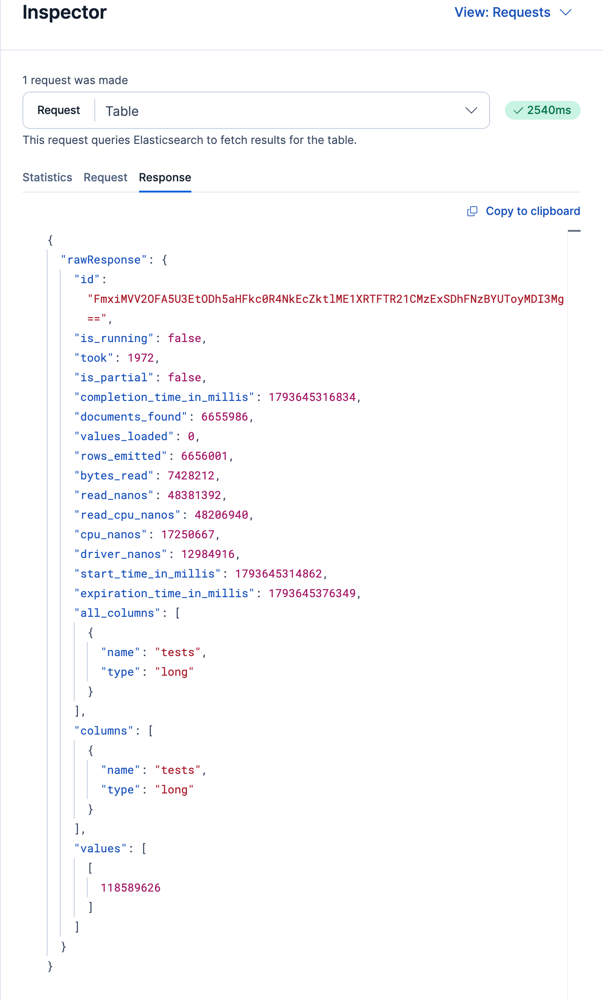

# Amazon S3 costs for {{esql}} Data Federation

{{esql}} Data Federation reads your data where it lives in Amazon S3, so AWS bills the bucket owner for the requests and data transfer that each query generates. This page explains what AWS charges for and how to reduce those charges. {{es}} reports the requests and bytes behind these charges, so you can estimate them. Your AWS bill shows what you actually pay. For an overview of all costs, refer to [](esql-data-federation-costs.md).

## What AWS charges for [s3-charges]

AWS bills the bucket owner for the following. {{es}} doesn't support Requester Pays buckets. For current rates, refer to [Amazon S3 pricing](https://aws.amazon.com/s3/pricing/).

Requests
:   A query can list objects (`ListObjectsV2`), check object metadata (`HEAD`), and read data with ranged `GET` requests. For Parquet files, a query reads at least one footer per file, plus the column chunks it needs. AWS bills `LIST` requests at the `PUT`, `COPY`, and `POST` rate rather than the `GET` rate. Many small files mean many requests.

Data transfer
:   Reads incur no data transfer charge when your cluster runs in the same AWS region as the bucket. AWS bills reads from another region per GB, and reads by a cluster outside AWS at internet data transfer rates. Traffic that goes through a NAT gateway also incurs NAT gateway processing charges.

Retrieval fees
:   The S3 Standard-IA, S3 One Zone-IA, and S3 Glacier Instant Retrieval storage classes charge for each GB retrieved. Objects in archive storage classes can't be queried.

AWS KMS requests
:   Buckets encrypted with SSE-KMS can add an AWS KMS request for each object read. [S3 Bucket Keys](https://docs.aws.amazon.com/AmazonS3/latest/userguide/bucket-key.html) reduce these requests, but only for objects written after you enable them.

### Failed and repeated queries [s3-failed-repeated-queries]

AWS bills successful requests and most client errors, whatever the query outcome. A query that fails, is cancelled, or returns no rows can still list the bucket and read file metadata. AWS doesn't bill `5XX` server errors or some other error responses. For details, refer to [Billing for Amazon S3 error responses](https://docs.aws.amazon.com/AmazonS3/latest/userguide/ErrorCodeBilling.html).

File data isn't cached. Each query reads the rows it needs from S3, so running a query again or refreshing a dashboard sends new requests. One exception: an ungrouped `COUNT`, `MIN`, or `MAX` that {{es}} can answer from file statistics reads no row data, and the `profile` object reports `external_warm_aggregates` when this happens. File listings, schemas, and Parquet footers are cached on each node. For details, refer to [](esql-data-federation-querying.md#caching).

## Estimate the cost of a query [s3-estimate-cost]

To estimate what a query costs on the AWS side before you rely on it, run it with [profiling](esql-query-performance.md#profile-api-responses) turned on and read the request and byte counts from the response. The result is an estimate. For what AWS actually bills, refer to [](#s3-monitor-aws).

:::{important}
Profile output is intended for human debugging, and its format can change at any time. Don't build scripts or monitoring that depend on it.
:::

1. Choose a representative query, such as the query behind a dashboard panel. For a query from Discover or a dashboard, copy the request body from the Inspector's **Request** tab. It includes the time range that {{kib}} applies as a filter. To open the Inspector, refer to [](#s3-kibana-bytes-read).
2. Run the query with profiling turned on:

    ```console
    POST /_query
    {
      "query": "FROM my_dataset | WHERE status_code >= 500 | STATS COUNT(*) BY host",
      "profile": true
    }
    ```

3. In the response, add up the S3 requests and the bytes read. This response is abridged:

    ```console-result
    {
      ...
      "bytes_read": 7340032, <1>
      ...
      "profile": {
        ...
        "planning_bytes_read": 131072, <2>
        "planning_requests": 6, <3>
        ...
        "drivers": [
          {
            ...
            "operators": [
              {
                "operator": "ExternalDataSourceOperator",
                "status": {
                  ...
                  "request_count": 42 <4>
                }
              },
              ...
            ]
          },
          ...
        ]
      }
    }
    ```

    1. Bytes read while running the query. This value doesn't include the object storage reads {{es}} made while planning the query.
    2. Bytes read while planning the query, such as file footers. Add this value to `bytes_read`. The response omits this field when it's zero, for example when a repeated query reuses cached metadata. If `external_resolution_bytes_read` and `external_resolution_requests` are present, they're a breakdown of `planning_bytes_read` and `planning_requests`, not values to add on top.
    3. Requests sent while planning the query, such as listing files and reading file metadata. Like `planning_bytes_read`, it's omitted when it's zero.
    4. Requests sent by this operator while reading data. To get the total, add the `request_count` of every `ExternalDataSourceOperator` across all drivers to `planning_requests`.

4. Calculate the cost:

    :::{math}
    \text{cost} = \left( \frac{\text{requests}}{1000} \times P_{\text{requests}} + \text{GB read} \times (P_{\text{transfer}} + P_{\text{retrieval}}) \right) \times \text{runs}
    :::

    - {math}`P_{\text{requests}}` = your price per 1,000 requests.
    - {math}`P_{\text{transfer}}` = your price per GB transferred. There's no transfer charge in the same region.
    - {math}`P_{\text{retrieval}}` = your retrieval price per GB, for infrequent-access storage classes. Otherwise zero.
    - {math}`\text{GB read}` = `bytes_read` plus `planning_bytes_read`, converted to GB. AWS pricing pages don't say whether a GB of data transfer is {math}`10^9` or {math}`2^{30}` bytes. To keep the estimate conservative, divide by 1,000,000,000, which gives the higher result. For actual usage, refer to [](#s3-monitor-aws).
    - {math}`\text{runs}` = how often the query runs. A dashboard runs one query for each panel on every refresh, for each user who has it open. Also count alerting rules and scheduled jobs that run the query. Multiplying by {math}`\text{runs}` assumes every run reads the same data, which isn't the case for a query {{es}} answers from file statistics. Refer to [](#s3-failed-repeated-queries).

:::{tip}
Run the query twice to see the cost of a repeated query. The first run lists files and reads footers that later runs can reuse from the cache.
:::

### Limits of the estimate [s3-estimate-limits]

The request and byte counts can differ from what AWS bills:

- `request_count` doesn't include retries made inside the AWS SDK, so the actual request count can be higher.
- `planning_requests` counts `LIST`, `HEAD`, and `GET` requests together, although AWS bills `LIST` requests at the higher `PUT` rate.
- `bytes_read` includes bytes read from indices when the query also reads indices.

## Check bytes read for a query in {{kib}} [s3-kibana-bytes-read]

Every {{esql}} response includes `bytes_read`, so you can check it for queries that run in Discover or on a dashboard:

1. Open the Inspector:
    - In Discover, select {icon}`ellipsis` **More**, then **Inspect tab**.
    - On a dashboard, open the {icon}`boxes_vertical` panel menu, then select **Inspect**. The Inspector opens on the panel's data, so select **View: Data**, then **Requests**.
2. If the Inspector lists more than one request, select the {{esql}} request from the **Request** list.
3. Select the **Response** tab, and find `bytes_read` under `rawResponse`. The **Statistics** tab, which opens first, doesn't show it.

    The Response tab shows `bytes_read` near the top of the response:

    

This value doesn't include the object storage reads {{es}} made while planning the query, such as file footers, so it can be lower than the bytes AWS bills.

:::{note}
{{kib}} doesn't turn on profiling, so request counts aren't available there. To get them, follow the steps in [](#s3-estimate-cost).
:::

## Monitor S3 usage over time [s3-monitor-usage]

You can track S3 usage directly from {{es}} or from AWS.

### From {{es}} [s3-monitor-cluster]

The [usage API](https://www.elastic.co/docs/api/doc/elasticsearch/operation/operation-xpack-usage) (`GET /_xpack/usage`) reports cumulative counters for Data Federation under `esql.datasources.storage`. The counters cover every query, including queries from {{kib}}, and add up all nodes since each node started.

For example, to read only the S3 counters:

```console
GET /_xpack/usage?filter_path=esql.datasources.storage.*.total.s3,esql.datasources.storage.retries.total
```

The response looks like this:

```console-result
{
  "esql": {
    "datasources": {
      "storage": {
        "retries": { "total": 12 }, <1>
        "bytes_read": { "total": { "s3": 7516192768 } }, <2>
        "requests": { "total": { "s3": 18240 } }, <3>
        "errors": { "total": { "s3": 3 } }, <4>
        "throttled": { "total": { "s3": 0 } } <5>
      }
    }
  }
}
```

1. Retries across all storage providers.
2. Bytes read from S3.
3. Requests that read object data from S3.
4. S3 reads that failed and gave up after retrying. A terminal throttling failure is counted here as well as in `throttled`, so don't add the two.
5. S3 reads that gave up because AWS throttled them.

To estimate usage over a period, read the counters on a schedule and compare the differences. The counters reset when a node restarts. `requests.total.s3` and `bytes_read.total.s3` count only reads of file data while queries run. They don't include planning requests, such as listing and metadata reads, or retries inside the AWS SDK, so treat them as lower bounds.

### From AWS [s3-monitor-aws]

AWS reports the requests and data transfer it bills, in the units it bills. To attribute those charges to {{es}} and track them:

- Give each data source its own IAM user or role, so AWS logs and reports can tell {{es}} requests apart from other traffic. {{es}} doesn't set a distinctive user agent on S3 requests, so the identity is the reliable way to filter. Data sources that use anonymous access send no identity. If the bucket is yours, AWS bills you for those requests, but you can't separate them from other public traffic.
- Turn on [S3 server access logging](https://docs.aws.amazon.com/AmazonS3/latest/userguide/ServerLogs.html) or [CloudTrail data events](https://docs.aws.amazon.com/AmazonS3/latest/userguide/cloudtrail-logging-s3-info.html) for the bucket, and filter by that identity. AWS bills CloudTrail data events separately.
- Track trends and set alerts with AWS cost tools, such as S3 Storage Lens, AWS Cost Explorer with cost allocation tags on the bucket, or AWS Budgets.

## Reduce S3 costs [s3-reduce-costs]

To reduce S3 costs, you'll need to minimize the number of requests sent and the amount of data read. The following practices help:

- Run your cluster in the same AWS region as the bucket.
- Store data as Parquet. Parquet reads only the columns a query needs and skips row groups that filters rule out. CSV and NDJSON read every row.
- Combine many small files into fewer, larger files. Each file needs its own requests.
- Partition data by commonly filtered fields, and put partition filters before `LIMIT`, `SORT`, and `STATS`. Set [`partition_spec`](esql-data-federation-partition-spec.md) so filters on columns inside the files, such as timestamps, can also skip folders. For details, refer to [](esql-data-federation-querying.md#partition-pruning).
- Use `KEEP`, `WHERE`, and `LIMIT` to read only what a query needs.
- Lengthen dashboard refresh intervals and narrow time ranges.
- Keep frequently queried data out of infrequent-access storage classes.
- Enable S3 Bucket Keys for SSE-KMS buckets.

### Discovery limits [s3-discovery-limits]

The [`esql.external.max_discovered_files`](esql-data-federation-cluster-settings.md#esql-external-max-discovered-files) and [`esql.external.max_listed_objects`](esql-data-federation-cluster-settings.md#esql-external-max-listed-objects) cluster settings limit file discovery for each dataset. They protect the cluster from glob patterns that match too many objects, so they aren't a cost control. Lowering them limits how many objects {{es}} lists and how many files it keeps, which also limits the requests that discovery sends. For the defaults and how the limits apply, refer to [](esql-data-federation-querying.md#file-discovery-limits).

Each 1,000 objects listed costs at least one `LIST` request. `esql.external.max_listed_objects` applies to each listing, and not every discovery path checks it, so treat it as a brake on runaway listings rather than a budget.

`esql.external.max_concurrent_requests` isn't a cost limit. It caps how many requests each node has in flight at once, not how many it sends.
