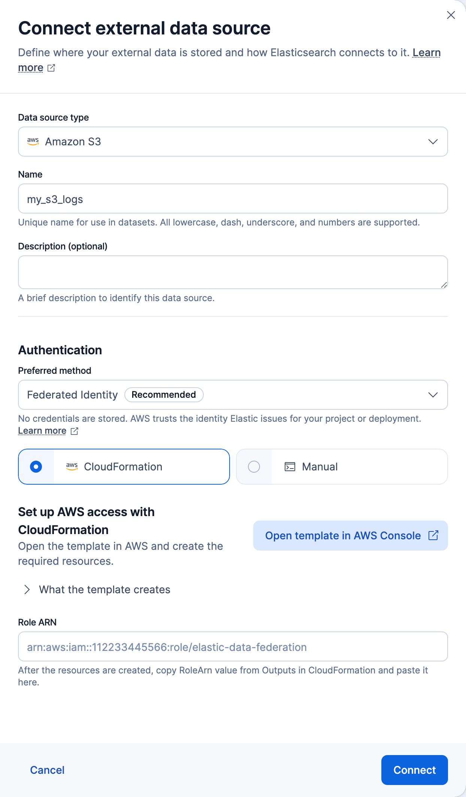

# Connect to Amazon S3 with federated identity for {{esql}} Data Federation

Federated identity lets {{es}} read an Amazon S3 data source without you storing any static AWS credentials. You configure AWS to trust the identities that Elastic Cloud issues for your project or deployment, and AWS grants {{es}} temporary, scoped read access to your bucket.

Setup happens in both Elastic and AWS:

1. Elastic gives you a CloudFormation template or AWS CLI commands with your project or deployment's values filled in.
2. You create the AWS resources and grant them read access to your bucket.
3. You connect the data source in Elastic.

Refer to the [AWS IAM documentation](https://docs.aws.amazon.com/IAM/latest/UserGuide/id_roles_providers_create_oidc.html) as the authoritative reference for the AWS commands shown here.

## Before you begin

To follow this guide, you need:

- An {{ech}} deployment with [{{esql}} Data Federation enabled](esql-data-federation.md#enable-the-feature). Federated identity is:
  - Available on {{ech}} on AWS, Azure, and Google Cloud.
  - Not available on IBM Cloud, in special environments such as AWS GovCloud, or on self-managed, ECE, or ECK deployments.
- The cluster `manage` privilege, to use the {{esql}} Data Federation UI. Refer to [privileges](esql-data-federation-security.md#privileges).
- An S3 bucket containing the files you want to query.
- An AWS identity that can create IAM resources. The permissions depend on your setup method.

:::{dropdown} Required AWS permissions
The AWS identity needs the following permissions:

- For either setup method, to grant the role read access to your bucket: `iam:CreatePolicy` and `iam:AttachRolePolicy`.
- For [manual setup](#create-aws-resources-manually): `iam:CreateOpenIDConnectProvider`, `iam:GetOpenIDConnectProvider`, and `iam:CreateRole`. If your AWS account already has an identity provider for your Elastic issuer and it doesn't list your audience, you also need `iam:AddClientIDToOpenIDConnectProvider`.
- For [CloudFormation setup](#create-aws-resources-with-cloudformation):
  - CloudFormation: `cloudformation:CreateStack`, `cloudformation:DescribeStacks`, `cloudformation:DescribeStackEvents`, and `cloudformation:GetTemplateSummary`
  - IAM: `iam:CreateRole`, `iam:GetRole`, `iam:AttachRolePolicy`, `iam:PutRolePolicy`, `iam:GetRolePolicy`, and `iam:PassRole`
  - Lambda: `lambda:CreateFunction`, `lambda:GetFunction`, and `lambda:InvokeFunction`
  - CloudWatch Logs: `logs:CreateLogGroup`, `logs:PutRetentionPolicy`, and `logs:DescribeLogGroups`

To delete these resources later, you also need the matching `Delete*` permissions.
:::

## Start setup in Elastic

Both setup methods start in Elastic:

1. Go to **Data management** > **{{esql}} Data Federation**.
2. Select the **Data sources** tab.
3. Click **Connect data source**.
4. Set **Data source type** to **Amazon S3**.
5. Enter a **Name** for the data source.
6. Under **Authentication**, keep **Federated Identity** selected as the **Preferred method**.

Keep the flyout open while you create the AWS resources.

Then choose a setup method:

- [CloudFormation](#create-aws-resources-with-cloudformation): Recommended. A template creates the AWS resources for you.
- [Manual](#create-aws-resources-manually): You create the resources yourself, for example with the AWS CLI commands that Elastic shows.

## Create AWS resources with CloudFormation

In the flyout, **CloudFormation** is selected as the setup method by default:

:::{dropdown} CloudFormation setup in the Connect external data source flyout

:::

To set up federated identity with CloudFormation:

1. In the **Set up AWS access with CloudFormation** section, click **Open template in AWS Console**. AWS opens a new CloudFormation stack named `elastic-datasources-federated-identity-<id>` in a new tab, with your values filled in.
2. In AWS, create the stack:
   1. On the **Quick create stack** page, review the stack name and parameters.
   2. Under **Capabilities**, select the checkbox acknowledging that the template may create IAM resources.
   3. Click **Create stack**.
3. Wait until the stack status is `CREATE_COMPLETE`.
4. On the stack's **Outputs** tab, copy the **RoleArn** value.
5. [Grant the role read access](#grant-role-read-access) to your bucket. The template creates the role without any permissions.

### Template resources

The template creates the following resources:

- **IAM OpenID Connect identity provider**: Trusts your Elastic issuer. Created only if your AWS account doesn't have one yet. Every CloudFormation stack for the same issuer shares it, so deleting a stack doesn't delete the provider.
- **IAM role**: Named `ElasticEsqlDataFederation-<stack-id>`. Only your project or deployment can assume it.
- **Lambda function and log group**: Create or update the shared identity provider.

## Create AWS resources manually

In the flyout, select the **Manual** setup method.

Use one of the following approaches. Don't mix them, because the commands create the resources in a different order than the following steps:

- **Run the commands from Elastic**: Run all three in order in [AWS CloudShell](https://docs.aws.amazon.com/cloudshell/latest/userguide/welcome.html) or any shell with the AWS CLI configured, then continue with [connecting a data source and creating a dataset](#connect-data-source-and-create-a-dataset).
- **Create the resources yourself**: Follow these steps, for example in the AWS console or with infrastructure as code.

:::::::{stepper}

::::::{step} Create an OpenID Connect identity provider
Create an IAM identity provider that trusts the tokens Elastic issues, with the following values:

- **Provider URL**: Your issuer URL, the `JWT_ISSUER` value in the **Manual** commands.
- **Client ID**: `sts.amazonaws.com`. The Elastic UI always uses this audience. To use a custom audience, set the same value here and in the data source's `jwt_audience` setting, and connect the data source with the [Console or curl request](#connect-data-source).

:::{dropdown} Example: create the provider with the AWS CLI
For console-based setup, refer to the [AWS IAM documentation](https://docs.aws.amazon.com/IAM/latest/UserGuide/id_roles_providers_create_oidc.html). To create the provider with the AWS CLI, run:

```shell
aws iam create-open-id-connect-provider \
  --url "<elastic-jwt-issuer>" \
  --client-id-list "sts.amazonaws.com" <1>
```
1. If you use a custom audience, use the same value here, in the role's trust policy, and in the data source's `jwt_audience` setting.
:::

An AWS account can have only one identity provider for each issuer URL. If your account already has a provider for your Elastic issuer, for example from an earlier setup, reuse it instead of creating another:

1. Find the provider's ARN under **Identity providers** in the IAM console, or with `aws iam list-open-id-connect-providers`.
2. If the provider's client IDs don't include your audience, add it with `aws iam add-client-id-to-open-id-connect-provider`.

Note the provider ARN, whether you created the provider or reused it. You reference it in the role's trust policy next.
::::::

::::::{step} Create an IAM role
Create an IAM role that the identity provider can assume through `sts:AssumeRoleWithWebIdentity`. The trust policy below restricts who can assume the role by matching the audience and subject from the Elastic-issued token.

The following trust policy lets your identity provider assume the role, but only when the token's audience and subject match your values. Replace the placeholders with the values for your environment:

```json
{
  "Version": "2012-10-17",
  "Statement": [
    {
      "Effect": "Allow",
      "Principal": {
        "Federated": "arn:aws:iam::<account-id>:oidc-provider/<issuer-host>/<path>" <1>
      },
      "Action": "sts:AssumeRoleWithWebIdentity",
      "Condition": {
        "StringEquals": {
          "<issuer-host>/<path>:aud": "sts.amazonaws.com", <2>
          "<issuer-host>/<path>:sub": "deployment:<deployment-id>" <3>
        }
      }
    }
  ]
}
```
1. The ARN of the identity provider you created in the previous step.
2. The condition key is the issuer URL with the `https://` scheme removed, followed by `:aud`. The value must match the client ID you set on the provider, and the data source's `jwt_audience`, which defaults to `sts.amazonaws.com`.
3. The condition key is the same issuer prefix followed by `:sub`. The value is your subject: `deployment:<deployment-id>` on {{ech}}, or `project:<project-id>` on serverless. It's the `SUBJECT` value in the **Manual** commands. This restricts the role to your project or deployment.

:::{dropdown} Example: create the role with the AWS CLI
To create the role with the AWS CLI:

1. Save the preceding trust policy to a file named `trust-policy.json`.
2. Create the role:

   ```shell
   aws iam create-role \
     --role-name "<role-name>" \
     --assume-role-policy-document file://trust-policy.json <1>
   ```
   1. The trust policy file from the previous step. `create-role` returns the role ARN.
:::

Note the role ARN that AWS returns. You enter it when you [connect the data source](#connect-data-source).
::::::
:::::::

Once the role is created, [grant it read access](#grant-role-read-access).

## Grant role read access

The role needs permission to read your bucket. Whether you need this section depends on how you created the role:

- **With CloudFormation**: The template creates the role without any permissions. Attach the following policy.
- **Manually**: If you ran the commands that Elastic shows, they already attached this policy, so continue with [Connect data source and create a dataset](#connect-data-source-and-create-a-dataset). If you created the resources in the AWS console or with infrastructure as code, attach the following policy.

The following policy grants the minimum access {{es}} needs: `s3:GetObject` to read your objects, and `s3:ListBucket` to list the bucket for prefix or glob queries:

```json
{
  "Version": "2012-10-17",
  "Statement": [
    {
      "Effect": "Allow",
      "Action": [ "s3:GetObject" ],
      "Resource": [ "arn:aws:s3:::<bucket-name>/<path>/*" ] <1>
    },
    {
      "Effect": "Allow",
      "Action": [ "s3:ListBucket" ],
      "Resource": [ "arn:aws:s3:::<bucket-name>" ] <2>
    }
  ]
}
```
1. Object-level actions apply to object ARNs. Narrow this to a prefix or a single file to grant the least access needed.
2. Bucket-level actions apply to the bucket ARN, not object ARNs. Include this statement only if you query by prefix or glob rather than a single fixed file.

:::{dropdown} Example: create and attach the policy with the AWS CLI
To create the policy and attach it to the role with the AWS CLI:

1. Save the preceding permissions policy to a file named `permissions-policy.json`.
2. Create the policy and attach it to the role. Replace `<role-name>` with the role's name, which is the last part of its ARN. For CloudFormation, it's the `ElasticEsqlDataFederation-<stack-id>` name at the end of the stack's `RoleArn` output.

   ```shell
   # Create the permissions policy
   POLICY_ARN=$(aws iam create-policy \
     --policy-name "<policy-name>" \
     --policy-document file://permissions-policy.json \
     --query 'Policy.Arn' --output text)

   # Attach it to the role
   aws iam attach-role-policy \
     --role-name "<role-name>" \
     --policy-arn "${POLICY_ARN}" <1>
   ```
   1. The policy ARN returned by `create-policy`. Attaching the policy authorizes the role to read your data.
:::

Once the policy is attached, [connect the data source and create a dataset](#connect-data-source-and-create-a-dataset).

## Connect data source and create a dataset

After the role can read your bucket, connect the data source and create a dataset that reads from it.

### Connect data source

Connect the data source with the role ARN from either setup method:

::::{tab-set}
:group: surface

:::{tab-item} UI
:sync: ui
To connect in the UI:

1. In the **Connect external data source** flyout you opened earlier, paste the role ARN into **Role ARN**.

   If you used CloudFormation and the ARN isn't the `ElasticEsqlDataFederation-<stack-id>` role that the template created, Elastic warns that it doesn't look like a CloudFormation-generated role.
2. Click **Connect**.

To learn more about connecting data sources, refer to [data sources](esql-data-federation-sources.md).
:::

:::{tab-item} Console
:sync: console
Create the data source with this request:

```console
PUT /_query/data_source/prod_s3_federated
{
  "type": "s3",
  "settings": {
    "auth": "federated_identity",
    "role_arn": "arn:aws:iam::112233445566:role/<role-name>", <1>
    "jwt_audience": "sts.amazonaws.com" <2>
  }
}
```
1. The ARN of the role you created in AWS.
2. If you use a custom audience, set `jwt_audience` to match the `aud` condition in the role's trust policy.
:::

:::{tab-item} curl
:sync: curl
Create the data source with this request:

```bash
curl -X PUT "${ELASTICSEARCH_URL}/_query/data_source/prod_s3_federated" \
  -H "Authorization: ApiKey ${API_KEY}" \
  -H "Content-Type: application/json" \
  -d '{
  "type": "s3",
  "settings": {
    "auth": "federated_identity",
    "role_arn": "arn:aws:iam::112233445566:role/<role-name>",
    "jwt_audience": "sts.amazonaws.com"
  }
}'
```
:::

::::

If federated identity isn't available for your project or deployment, connecting fails with an error. Refer to [Before you begin](#before-you-begin).

### Create a dataset

[Create a dataset](esql-data-federation-manage-datasets.md) that points at your files, for example `s3://amzn-s3-demo-bucket/some/sample.parquet` in **Parquet** format.

You can now query the remote data with {{esql}}.

:::{note}
If your bucket isn't in standard commercial AWS, set [`region`](esql-data-federation-dataset-settings.md#amazon-s3-region) on the dataset. With federated identity, the dataset's `region` also selects the STS endpoint used to assume the role, unless the data source sets [`sts_region`](esql-data-federation-data-source-settings.md#sts-region).
:::

## Next steps

Continue with the following dataset and security tasks:

- [Query your data](esql-data-federation-querying.md) with `FROM`, including metadata columns and current limitations.
- [Manage datasets](esql-data-federation-manage-datasets.md) over this data source, and review [file formats](esql-data-federation-file-formats.md) and [dataset settings](esql-data-federation-dataset-settings.md).
- [Manage credentials and privileges](esql-data-federation-security.md) to control who can access your data sources and datasets.
