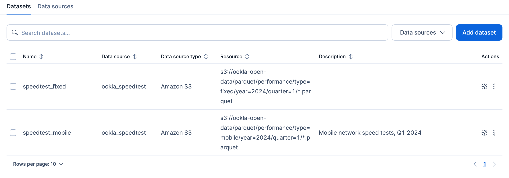
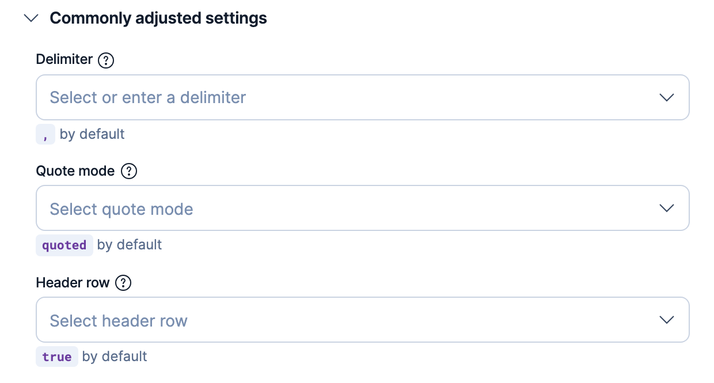
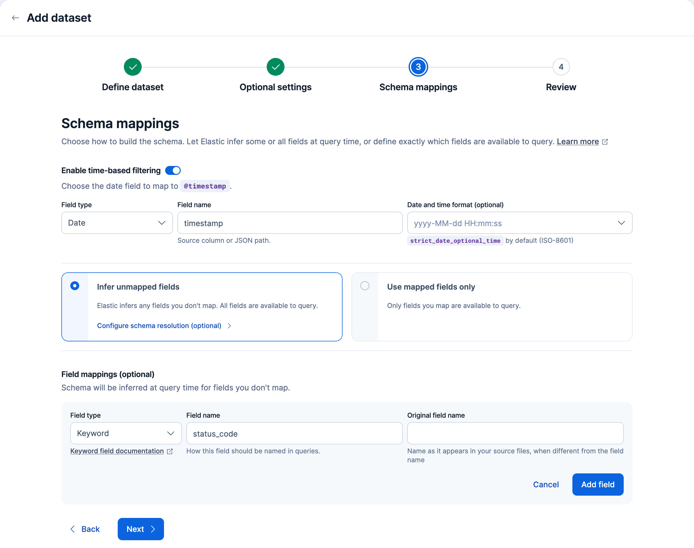
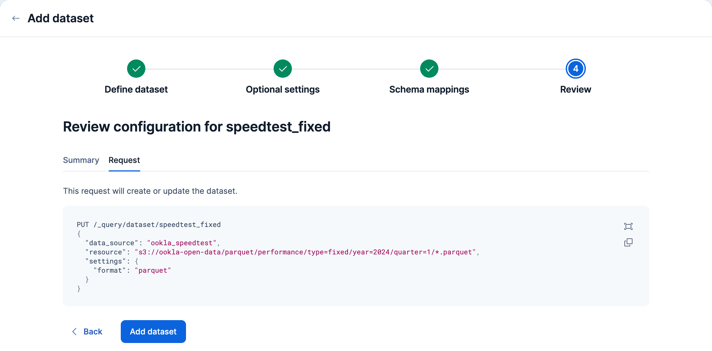

# Create and manage datasets in the {{kib}} UI

:::{include} _snippets/data-federation/experimental-warning.md
:::

In the {{kib}} UI, you create and manage datasets from the **Datasets** tab under **Data management** > **{{esql}} Data Federation**.

To use the UI, [enable it in {{kib}}](esql-data-federation.md#enable-the-feature) first. Every dataset reads from a [data source](esql-data-federation-sources.md). If you haven't connected one yet, you can connect it from the **Add dataset** wizard: select **Connect new data source** in the **Data source** menu.

## View datasets

The **Datasets** tab lists each dataset with its data source, data source type, resource, and description. You can search your datasets, filter them by data source, and add new ones. Each row has the following actions:

- **Open in Discover** ({icon}`product_discover`): Opens **Discover** with a `FROM <dataset>` query.
- **Edit** and **Delete**: Click **More actions** ({icon}`ellipsis`) at the end of the row, then select an action.

The following example shows two datasets that read from the same data source:



## Add a new dataset
```{applies_to}
stack: preview 9.6+
```

Click **Add dataset** to open a four-step wizard. A progress bar at the top of the page shows each step:


After you complete a step, you can return to it by clicking it in the progress bar.

### Define dataset

The first step sets what the dataset reads:

- **Data source**: The connected data source to read from. To connect a new one without leaving the wizard, select **Connect new data source**.
- **Dataset name**: A unique name for use in queries. Names must be lowercase and cannot begin with `-`, `_`, or `+`. A dataset cannot share a name with any existing index, data stream, alias, or view.
- **Description (optional)**: Up to 1,000 characters.
- **Resource**: The URI and glob pattern that selects the files to read. Refer to [resource patterns](esql-data-federation-patterns.md) for the pattern language.
- **Format**: Detected from the file extension in **Resource**. Select a format yourself when the pattern has no extension or matches more than one format. Detection never replaces a format you select. Refer to [supported file formats](esql-data-federation-file-formats.md).

:::{note}
Creating a dataset doesn't test whether the data source can read the files. Before you query the dataset, [grant read access](esql-data-federation-sources.md#grant-read-access) in your cloud provider.
:::

### Optional settings

The second step controls how the files are read. If your files match the defaults for their format, skip it. Hidden files, temporary files, and Delta Lake logs are already excluded, and Hive-style folder paths such as `year=2024/` are read as columns automatically.

Change settings in these cases:

- Your CSV or TSV files don't use the default layout:
  - For a separator other than a comma, set **Delimiter**.
  - For files without a header row, turn off **Header row**. Columns are then named by position, such as `col0` and `col1`.
  - For files that mark missing values with a string such as `NA`, set **Null value**.
- Your dates in CSV, TSV, or NDJSON files aren't in ISO 8601 format: set **Date and time format**.
- Your folder paths encode values in a pattern other than `key=value`: set **Partition detection** to **Template** and describe the pattern.
- Some rows are malformed: by default, one bad row fails the query. To skip bad rows or read their bad fields as null, change **Error mode**.

For CSV and TSV files, the settings you're most likely to change are grouped under **Commonly adjusted settings**, with each field's default shown below it:



To learn what each setting does, refer to [dataset settings](esql-data-federation-dataset-settings.md).

### Schema mappings

The third step sets the dataset's schema. To learn how declared and inferred columns combine, refer to [](esql-data-federation-schema.md#declare-a-schema-explicitly).

- **Enable time-based filtering**: On by default. In **Field name**, enter the date column to map to `@timestamp`, so queries and dashboards can filter the dataset by time.
- **Infer unmapped fields**: The default. Fields you don't map are inferred from the files. To choose how schemas from different files are combined, select **Configure schema resolution**.
- **Use mapped fields only**: Only the fields you map are available to query. You must map at least one field other than `@timestamp`.
- **Add field**: Maps a column. Set its **Field type** and the **Field name** to use in queries. If the column has a different name in your files, enter that name in **Original field name**.

:::{tip}
If your files have no date column, turn off **Enable time-based filtering**. Otherwise, you can't move to the next step without entering a **Field name**.
:::

#### Example

The following example maps two columns and infers the rest:

- The `timestamp` column is mapped to `@timestamp`.
- The **Add field** form declares `status_code` as a **Keyword** field. Because **Infer unmapped fields** is selected, this overrides the type inferred for `status_code`.
- Every other column is still inferred from the files.



### Review

The last step summarizes the dataset on the **Summary** tab. The **Request** tab shows the equivalent create request, which you can copy and run in the Dev Tools [Console](docs-content://explore-analyze/query-filter/tools/console.md) to create the same dataset with the API:



Click **Add dataset** to create the dataset.

## Edit a dataset
```{applies_to}
stack: preview 9.6+
```

To change a dataset:

1. Click **More actions** ({icon}`ellipsis`) at the end of the dataset's row.
2. Select **Edit**. The wizard opens with the dataset's current configuration.
3. Update the settings in any step.
4. On the **Review** step, click **Save**.

:::{warning}
Changing the **Dataset name** saves the dataset under the new name and then deletes the dataset with the old name. Queries that use the old name stop working.
:::

## Next steps

:::{include} _snippets/data-federation/datasets-next-steps.md
:::
