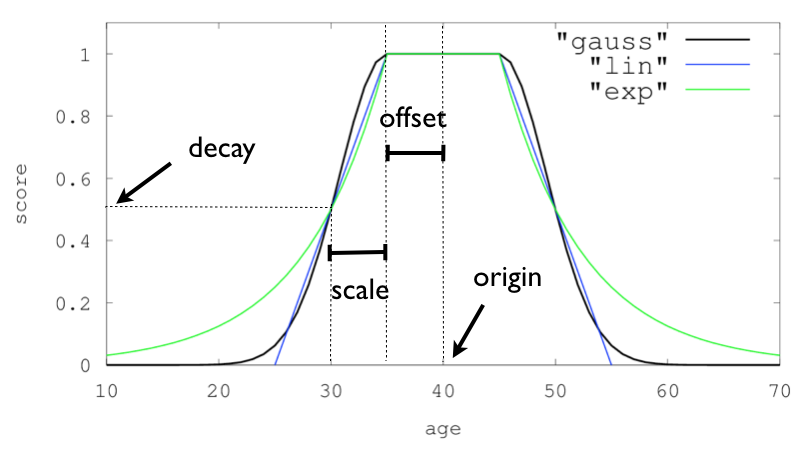

---
applies_to:
  stack: preview 9.3-9.6, ga 9.7+
  serverless: ga
navigation_title: "Score by distance"
description: "Use DECAY in ES|QL to score rows by how close a number, date, or point is to an origin, and to combine that score with search relevance."
type: overview
products:
  - id: elasticsearch
---

# Score by distance with {{esql}} `DECAY` [esql-decay-scoring]

[`DECAY`](/reference/query-languages/esql/functions-operators/search-functions/decay.md) gives a value a score between
0 and 1 based on its distance from an origin. Values at the origin score 1, and the score drops smoothly as the
distance grows. Use it to prefer recent documents, places near a location, or prices near a target, and to blend that
preference with the relevance score of a search.

`DECAY` is the {{esql}} counterpart of the
[decay functions](/reference/query-languages/query-dsl/query-dsl-function-score-query.md#function-decay) of the
`function_score` query and computes the same scores. Instead of query options such as `boost_mode`, you combine its
result with other values using {{esql}} expressions.

This query scores employees by how close their salary is to 50,000:

```esql
FROM employees
| EVAL score = ROUND(DECAY(salary, 50000, 10000), 3)
| SORT score DESC, emp_no
| KEEP emp_no, salary, score
| LIMIT 3
```

| emp_no | salary | score |
| --- | --- | --- |
| 10046 | 50064 | 0.997 |
| 10081 | 50128 | 0.994 |
| 10082 | 49818 | 0.991 |

## Parameters [esql-decay-scoring-parameters]

```esql
DECAY(value, origin, scale, {"offset": offset, "decay": decay, "type": type})
```

`value`
:   The value to score: a numeric, `date`, `date_nanos`, `geo_point`, or `cartesian_point` value.

`origin`
:   The point from which the distance is measured. A constant of the same kind as `value`.

`scale`
:   The distance beyond `offset` at which the score equals `decay`. A constant greater than 0.

`offset`
:   Optional. Distance from `origin` within which the score stays 1. Defaults to 0, and must not be negative.

`decay`
:   Optional. The score at `scale` beyond `offset`. Defaults to 0.5, and must be greater than 0 and less than 1.

`type`
:   Optional. The shape of the curve: `linear` (the default), `exp`, or `gauss`.

Rather than setting the steepness of the curve directly, you say what score a distance gets. For example, "values 10
away from the origin score 0.5" is a `scale` of 10 with the default `decay` of 0.5, and `DECAY` derives the curve
that goes through that point. A `scale`, `offset`, or `decay` outside its valid range is an error.

### Units [esql-decay-scoring-units]

The unit of `scale` and `offset` depends on the type of `value`:

| Type of `value` | `origin` | `scale` and `offset` |
| --- | --- | --- |
| Numeric | Any numeric value | Numbers, such as `10` or `2.5` |
| `date` or `date_nanos` | A `date` or `date_nanos` value | Time durations, such as `12 hours`, or periods of days and weeks, such as `7 days` |
| `geo_point` | A `geo_point`, such as `TO_GEOPOINT("POINT(2.35 48.86)")`, with the longitude first | Distance strings, such as `"200km"` or `"5mi"`. Without a unit, the distance is in meters |
| `cartesian_point` | A `cartesian_point` | Numbers |

{applies_to}`stack: ga 9.7+` Periods of days and weeks are accepted for dates. Months and years have no fixed length,
so periods that contain them are rejected.

This query scores employees by how close they were hired to the start of 1990. Hires within 30 days of it all score 1:

```esql
FROM employees
| EVAL score = ROUND(DECAY(hire_date, TO_DATETIME("1990-01-01T00:00:00Z"), 365 days, {"offset": 30 days}), 3)
| SORT score DESC, emp_no
| KEEP emp_no, hire_date, score
| LIMIT 5
```

| emp_no | hire_date | score |
| --- | --- | --- |
| 10011 | 1990-01-22T00:00:00.000Z | 1.0 |
| 10023 | 1989-12-17T00:00:00.000Z | 1.0 |
| 10082 | 1990-01-03T00:00:00.000Z | 1.0 |
| 10096 | 1990-01-14T00:00:00.000Z | 1.0 |
| 10056 | 1990-02-01T00:00:00.000Z | 0.999 |

To favor recent documents, use [`NOW`](/reference/query-languages/esql/functions-operators/date-time-functions/now.md)
as the origin, for example `DECAY(@timestamp, NOW(), 7 days)`.

## Decay curves [esql-decay-scoring-curves]

The `type` option sets how the score falls off with the distance `d`, which is the distance from `origin` minus
`offset`, and at least 0.

`linear`
:   Falls in a straight line and reaches 0 at a distance of `scale / (1 - decay)`, which is twice the `scale` with the
    default `decay` of 0.5:

    :::{math}
    S = max \left( \dfrac{s - d}{s}, 0 \right), \quad s = \dfrac{scale}{1 - decay}
    :::

`exp`
:   Falls quickly near the origin and then more slowly, without reaching 0:

    :::{math}
    S = exp(\lambda \cdot d), \quad \lambda = \dfrac{ln(decay)}{scale}
    :::

`gauss`
:   Falls slowly near the origin, then quickly, then slowly again, without reaching 0:

    :::{math}
    S = exp \left( - \dfrac{d^2}{2\sigma^2} \right), \quad \sigma^2 = - \dfrac{scale^2}{2 \cdot ln(decay)}
    :::

All three curves go through the score `decay` at distance `scale`. This query compares them for a `scale` of 10:

```esql
ROW distance = [0, 5, 10, 15, 20, 30]
| MV_EXPAND distance
| EVAL linear = ROUND(DECAY(distance, 0, 10), 3),
       exp = ROUND(DECAY(distance, 0, 10, {"type": "exp"}), 3),
       gauss = ROUND(DECAY(distance, 0, 10, {"type": "gauss"}), 3)
```

| distance | linear | exp | gauss |
| --- | --- | --- | --- |
| 0 | 1.0 | 1.0 | 1.0 |
| 5 | 0.75 | 0.707 | 0.841 |
| 10 | 0.5 | 0.5 | 0.5 |
| 15 | 0.25 | 0.354 | 0.21 |
| 20 | 0.0 | 0.25 | 0.063 |
| 30 | 0.0 | 0.125 | 0.002 |

An `offset` shifts the curve away from the origin. With an `offset` of 5, every distance up to 5 scores 1, and the
curve then falls as before:

```esql
ROW distance = [0, 5, 10, 15, 20]
| MV_EXPAND distance
| EVAL linear = ROUND(DECAY(distance, 0, 10, {"offset": 5}), 3)
```

| distance | linear |
| --- | --- |
| 0 | 1.0 |
| 5 | 1.0 |
| 10 | 0.75 |
| 15 | 0.5 |
| 20 | 0.25 |

The following chart shows the three curves with an origin, an offset, and a scale:



## Combine with relevance [esql-decay-scoring-relevance]

To boost search results, multiply the relevance score [`_score`](/reference/query-languages/esql/esql-metadata-fields.md)
by `DECAY`. This query finds books by Faulkner and favors those published close to 2005. The `exp` curve with a
`decay` of 0.25 and a `scale` of 1 keeps a quarter of the score for each year away from 2005:

```esql
FROM books METADATA _score
| WHERE MATCH(author, "Faulkner")
| EVAL boosted = _score * DECAY(year, 2005, 1, {"type": "exp", "decay": 0.25})
| SORT boosted DESC
| KEEP book_no, author, year
| LIMIT 2
```

| book_no | author | year |
| --- | --- | --- |
| 2883 | William Faulkner | 2005 |
| 3293 | Danny Faulkner | 2004 |

Multiplying keeps the order of documents at the same distance and scales the others down. Other combinations give
`DECAY` a different weight:

* `_score * DECAY(...)` lets the distance reduce the relevance score. This matches the default `boost_mode` of
  `function_score`.
* `_score + DECAY(...)` adds a bonus of at most 1, so the distance matters most when the relevance scores are close.
* `_score * (1 + DECAY(...))` boosts documents near the origin by up to twice their score, and keeps the score of
  distant documents.

## Combine several factors [esql-decay-scoring-several]

To score on several criteria, multiply their decay scores, as the `multiply` score mode of `function_score` does.
This query looks for airports near Paris and favors the major ones. `proximity` uses a `gauss` curve that halves the
score at 100 km. `importance` uses the `scalerank` field, which is 1 for the largest airports, and halves the score
at a rank of 5:

```esql
FROM airports
| EVAL proximity = DECAY(location, TO_GEOPOINT("POINT(2.3522 48.8566)"), "100km", {"type": "gauss"}),
       importance = DECAY(scalerank, 1, 4)
| EVAL score = ROUND(proximity * importance, 3)
| SORT score DESC, abbrev
| KEEP abbrev, name, scalerank, score
| LIMIT 3
```

| abbrev | name | scalerank | score |
| --- | --- | --- | --- |
| CDG | Charles de Gaulle Int'l | 2 | 0.845 |
| ORY | Paris Orly | 4 | 0.617 |
| XCR | Châlons Vatry | 7 | 0.071 |

Charles de Gaulle and Orly are both close to the center of Paris, but Charles de Gaulle ranks first because it is the
larger airport.

## Multivalued fields [esql-decay-scoring-multivalued]

`DECAY` scores a single value. For a [multivalued field](/reference/query-languages/esql/esql-multivalued-fields.md)
it returns `null` and adds a warning.

To score the value closest to the origin, which is what `function_score` does by default, expand the field with
[`MV_EXPAND`](/reference/query-languages/esql/commands/mv_expand.md) and keep the highest score of each document with
[`STATS`](/reference/query-languages/esql/commands/stats-by.md). Use `MIN` instead of `MAX` to score the value
farthest from the origin.

```esql
FROM employees
| KEEP emp_no, salary_change
| MV_EXPAND salary_change
| STATS score = ROUND(MAX(DECAY(salary_change, 10, 5)), 3) BY emp_no
| SORT score DESC NULLS LAST, emp_no
| LIMIT 3
```

| score | emp_no |
| --- | --- |
| 0.998 | 10078 |
| 0.965 | 10011 |
| 0.963 | 10075 |

## Missing values [esql-decay-scoring-missing]

When `value` is `null`, for example because a document doesn't have the field, `DECAY` returns `null`. To give these
documents a fixed score, use [`COALESCE`](/reference/query-languages/esql/functions-operators/conditional-functions-and-expressions/coalesce.md).
For example, `COALESCE(DECAY(year, 2011, 10), 0.5)` scores books without a year 0.5, and `COALESCE(..., 1)` matches
`function_score`, which scores documents without the field 1.

## Differences from `function_score` decay functions [esql-decay-scoring-differences]

| `function_score` | {{esql}} `DECAY` |
| --- | --- |
| `gauss`, `exp`, and `linear` functions | The `type` option |
| `origin` defaults to `now` for dates, and accepts date math | `origin` is required. Use `NOW()` or an expression such as `NOW() - 1 day` |
| `multi_value_mode` | `MV_EXPAND`, then `STATS` with `MAX` or `MIN` of `DECAY` |
| Documents without the field score 1 | `DECAY` returns `null`. Use `COALESCE` to choose the score |
| `boost_mode`, `score_mode`, and `weight` | Arithmetic on `_score` and on the results of `DECAY` |
| `scale` and `offset` as strings with units, such as `"10d"` or `"2km"` | Time durations and periods such as `10 days` for dates, and distance strings such as `"2km"` for geo points |
