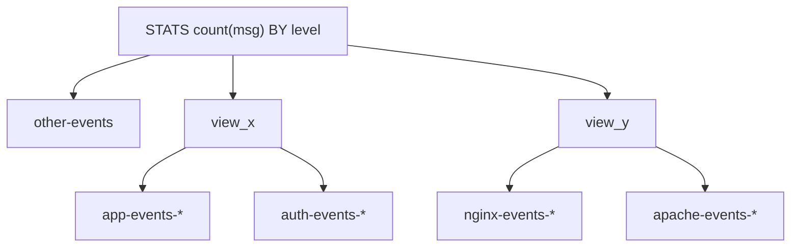
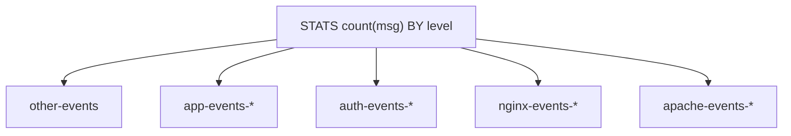

# Define reusable queries with {{esql}} views [esql-views]

A view is a virtual index defined by an {{esql}} query. It stores the query, not its results. You reference a view by name in the [`FROM`](/reference/query-languages/esql/commands/from.md) command, just like an ordinary index, and {{es}} resolves and runs the query each time the view is referenced. Results always reflect the current data and the current view definition, so when you update a view, every query, dashboard, and alert that references it uses the new definition on its next run.

A view has the following components:

* **Name**: used anywhere an index name is accepted in `FROM`. Refer to [](#esql-views-names) for naming rules.
* **View definition**: a complete {{esql}} query that runs each time the view is referenced. In the REST API, this is the `query` field.
* {applies_to}`stack: ga 9.6+` **Description**: optional text that explains the view's purpose.

## Basic example

Here's how a view works in practice:

:::::::{stepper}

::::::{step} Start with a query

:::{include} _snippets/commands/examples/views.csv-spec/views_plain_addresses.md
:::

::::::

::::::{step} Save it as a view

```console
PUT /_query/view/country_addresses
{
    "query": """
        FROM addresses
        | RENAME city.country.name AS country
        | EVAL country = CASE(country == "United States of America", "United States", country)
        | STATS count=COUNT() BY country
        """
}
```

::::::

::::::{step} Reference it by name, just like an index

:::{include} _snippets/commands/examples/views.csv-spec/views_country_addresses.md
:::

::::::

:::::::

## When to use views

Views are a good fit when you want to:

* **Reuse a named query.** Wrap a frequently used {{esql}} pipeline as a view and reference it by name, instead of repeating the same query in every request.
* **Abstract common transformations.** Centralize renames, type conversions, or derived fields so consumers see a consistent set of columns without needing to know the underlying source structure.
* **Combine pre-processed data sources.** Define one view per source, each with its own filters or aggregations, and query them together in a single `FROM` clause.
* **Simplify queries for downstream tools.** Dashboards, alerts, or ad-hoc analysts can query `FROM my_view` without needing to know the indices or processing commands behind it.

## Create and manage views

Use the REST API to create, update, delete, and list views:

* [Create or update a view](https://www.elastic.co/docs/api/doc/elasticsearch/operation/operation-esql-put-view)
* [Delete a view](https://www.elastic.co/docs/api/doc/elasticsearch/operation/operation-esql-delete-view)
* [Get or list views](https://www.elastic.co/docs/api/doc/elasticsearch/operation/operation-esql-get-view)

{applies_to}`{"stack": "ga 9.6+", "serverless": "ga"}` You can also create and manage views in {{kib}}. Refer to [](#esql-views-kibana).

### Query validation [esql-views-validation]
`PUT /_query/view/<name>` rejects a query that cannot be parsed.

{applies_to}`stack: ga 9.7+` To check the query without running it, set the `validate` query parameter to `true`. Validation is off by default.

With `validate=true`:

* If the query uses an index or column that does not exist, the response carries a `Warning` header.
* A warning does not stop {{es}} from saving the view. The view is saved whether or not validation reports a problem, so you can create a view before the index it reads from.
* The analysis uses your privileges. An index you cannot read is reported as unknown.
* Failures unrelated to the query, such as an overloaded cluster, produce no warning.

### Reserved views [esql-views-reserved]
```{applies_to}
stack: ga 9.6+
serverless: ga
```

Reserved views are created by {{es}} or its components, so they're read-only. You can query and read them like any other view, subject to the same [privileges](#esql-views-privileges). The [get view](https://www.elastic.co/docs/api/doc/elasticsearch/operation/operation-esql-get-view) response marks them with `"reserved": true`.

The REST API rejects these requests:

* `PUT /_query/view/<name>` when a reserved view with that name exists. You also can't set `reserved` in a request.
* `DELETE /_query/view/<name>`, with the error `cannot delete reserved view [<name>]`.

### Create and manage views in {{kib}} [esql-views-kibana]
```{applies_to}
stack: ga 9.6+
serverless: ga
```

You can also work with views directly in {{kib}}:

* [Create a view from the {{esql}} editor](docs-content://explore-analyze/query-filter/languages/esql-kibana.md#esql-kibana-views-create) in Discover or a dashboard.
* [Manage views](docs-content://explore-analyze/query-filter/languages/esql-kibana.md#esql-kibana-views-manage) from the **{{esql}} Views** page, where you can list, edit, delete, and open them in Discover.

### View names [esql-views-names]

Views share a namespace with indices, aliases, and data streams. You can't create a view with the same name as an existing index, alias, or data stream, and you can't create any of these with the name of an existing view. {{es}} rejects the request with an error that names the conflicting resource. This keeps `FROM name` resolution unambiguous.

{applies_to}`stack: preview 9.6+, experimental =9.5` The same rule applies to [datasets](/reference/query-languages/esql/esql-data-federation-datasets.md), which [{{esql}} Data Federation](/reference/query-languages/esql/esql-data-federation.md) uses to query external data.

## Query a view

Use views as if they were ordinary indices:

```esql
FROM index_pattern
```

Where `index_pattern` is a comma-separated list of index or view names. Index
expressions can include wildcards and date math. Whether a wildcard also matches
views depends on the version and deployment type.

### Wildcard patterns and views [esql-views-wildcards]
::::{applies-switch}
:::{applies-item} { "stack": "ga 9.6+", "serverless": "ga" }
By default, a wildcard pattern in `FROM` does not match views. `FROM my-view-1`
reads the view by exact name, while `FROM my-view-*` resolves to indices, data
streams, and aliases only. Registered views are excluded.

To include views in wildcard resolution, enable the `wildcards_match_views` setting:

```esql
SET wildcards_match_views = true;
FROM my-view-*
```

You can also send it in the `_query` request body as `"settings": {"wildcards_match_views": true}`. A value set in the query overrides the request body, but neither value enters a referenced view. Refer to [Settings across view boundaries](#settings-across-view-boundaries) for the limits and warnings.

{applies_to}`stack: ga 9.6+` As an alternative, set the cluster-wide default
with `esql.query.settings.wildcards_match_views` in `elasticsearch.yml` or
through the cluster settings API. The cluster default applies both outside and
inside views.

:::
:::{applies-item} stack: preview 9.4-9.5
Wildcard patterns in `FROM` match registered views automatically.
:::
::::

## Privileges [esql-views-privileges]

View operations use the standard {{es}} [index privileges](../../elasticsearch/security-privileges.md#privileges-list-indices), applied to the view name.

| Operation | Privilege (on the view name) |
|---|---|
| Query (`FROM my_view`) | `read`, `all` |
| Create or update (`PUT /_query/view/<name>`) | `create_view`, `manage_view`, `manage`, `all` |
| Read definition (`GET /_query/view/<name>`) | `read_view_metadata`, `manage_view`, `manage`, `all` |
| Delete (`DELETE /_query/view/<name>`) | `delete_view`, `manage_view`, `manage`, `all` |

### Views are not a security boundary

`read` on a view name permits querying the view but does **not** grant access to the data behind it. The caller must also have `read` on every index or alias the view definition resolves to, including through nested views.

Access is enforced at query time. Creating a view requires no privilege over the indices it references.

If some underlying indices are unauthorized, the query fails with a `403`. If none are accessible, it fails with a `400 Unknown index`. Wildcard patterns (`FROM view-*`) silently exclude unauthorized views.

Nested views are resolved under the calling user's credentials. Access to an outer view does not grant access to any inner view it references.

### Document- and field-level security

`read` on a view name must not carry DLS or FLS. If it does, the query fails with a `403` and the `views_with_dls_or_fls` error field lists the affected names. This applies at every nesting level.

DLS or FLS on the **underlying indices** is applied normally.

### Example role

```json
{
  "indices": [
    {
      "names": ["country_addresses"],
      "privileges": ["read", "create_view", "read_view_metadata", "delete_view"]
    },
    {
      "names": ["addresses"],
      "privileges": ["read"]
    }
  ]
}
```

## Examples

The following examples show how to use views within the `FROM` command.

### Combine data from multiple indices

Assume we've defined three views in a similar way to the example above, each counting the number of documents that reference a particular country, but from three different source indices:
* `country_airports` - reports counts of documents per country from our `airports` index
* `country_addresses` - reports counts of documents per country from our `addresses` index
* `country_languages` - reports counts of documents per country from our `languages` index

Now we can query these together with a query like:

:::{include} _snippets/commands/examples/views.csv-spec/views_country_filtered.md
:::

The same country might appear in multiple views, producing multiple rows.
We could combine these with a `STATS` command, using `SUM(count) BY country`.

### Use wildcards
```{applies_to}
stack: ga 9.6+, preview 9.4-9.5
serverless: ga
```

:::{note}
:applies_to: { "stack": "ga 9.6+", "serverless": "ga" }
This example requires `wildcards_match_views = true`. By default, wildcards do
not match views. Refer to [wildcard patterns and views](#esql-views-wildcards)
and review the [{{esql}} view limitations](#esql-views-limitations).
:::

:::{include} _snippets/commands/examples/views.csv-spec/views_country_wildcard_sum.md
:::

Note how we used `SUM` to combine the counts of the three previously aggregated `count` columns.

### Use LOOKUP JOIN inside a view

We can define views with complex queries, including commands like `LOOKUP JOIN`:

```console
PUT /_query/view/airports_mp_filtered
{
    "query": """
        FROM airports
        | RENAME abbrev AS code
        | LOOKUP JOIN airports_mp ON abbrev == code
        | WHERE abbrev IS NOT NULL
        | DROP code
       """
}
```

This creates a view called `airports_mp_filtered` that contains all rows from the `airports` index that also have a matching `abbrev` inside the `airports_mp` index.
This is effectively a subset of the `airports` index.

We could, for example, see how many airports are defined only in `airports` versus how many are defined in the view, by combining both a view and an index in the same `FROM` command:

:::{include} _snippets/commands/examples/views.csv-spec/airports_mp_filtered_combined.md
:::

### Views with METADATA [views-with-metadata]

The [`METADATA` directive](/reference/query-languages/esql/esql-metadata-fields.md) is supported both inside and outside a view.
Views follow the same rules as [subqueries](/reference/query-languages/esql/esql-from-subquery.md#subqueries-with-metadata).

Inside the view, the directive generates columns just like other fields. You can use them for filtering and as output columns.

:::{include} _snippets/common/outer_metadata_rules.md
:::

:::{warning}
:applies_to: stack: preview =9.4
`METADATA` on the outer `FROM` is not handled consistently.

If the `FROM` names only a view, the directive is ignored. For example, `FROM my_view METADATA _index` returns the view contents without an `_index` column.

:::{include} _snippets/common/outer_metadata_9_4_warning.md
:::
:::

{applies_to}`stack: ga 9.6+` `_class` and `_name` are the only metadata fields that work on a view without the view body declaring them. The outer query answers them for each view. `_class` is `view`. `_name` is the view name. You do not need the directive inside the view. If the view body also declares `_class` or `_name`, the outer values replace them.

:::{include} _snippets/generated/x-pack-esql/commands/examples/views.csv-spec/views_class_and_name.md
:::

## How views execute

Views behave like inline subqueries at execution time and when you start combining multiple views, it helps to know how nesting works and where the limits are.

### Execution model

When a query references one or more views, each view's definition query executes independently at query time, in parallel where possible. This is the same execution model used by [`FROM` subqueries](/reference/query-languages/esql/esql-from-subquery.md) and [`FORK`](/reference/query-languages/esql/commands/fork.md).

Results from all sources (indices, views, subqueries) are unioned into a single result set. Duplicate rows are preserved. Columns that exist in one source but not another are filled with `null`.

### Nesting and branching

A view definition can reference another view. This is called a nested view. {{esql}} allows nesting to a depth of 10.

When multiple views are referenced within the same index pattern, each view executes independently (in parallel if possible), similar to subqueries and [`FORK`](/reference/query-languages/esql/commands/fork.md).

::::{applies-switch}

:::{applies-item} { "stack": "ga 9.6+", "serverless": "ga" }
[Query compaction](#query-compaction) flattens nested view branches into one merge only when the result has at most 20 branches by default (`esql.query.max_branch_count`). If flattening would exceed that cap, {{esql}} keeps the nested plan instead of failing the query. The same setting also caps the total number of leaf branches in the query.

A query and the views and subqueries it references are limited to 500 commands in total (`esql.query.max_command_count`). The limit applies both to the query as written and to the expanded plan after every view and subquery body is inlined, so deeply nested or heavily repeated view references fail instead of consuming unbounded memory.
:::

:::{applies-item} stack: preview 9.4-9.5
Views, subqueries, and `FORK` share a maximum branch count of 8. For example, a single index pattern could reference four views and four subqueries, but adding one more would exceed the limit and the query will fail.
:::

::::

### Combining branching and nesting [combining-branching-and-nesting]

::::{applies-switch}

:::{applies-item} { "stack": "ga 9.6+", "serverless": "ga" }
Nested branching is supported. A view definition can contain `FROM` subqueries,
nested views, and `FORK`, and a query can combine that view with other
branched sources. The complete expanded query remains subject to the branch and
command limits described above. The restriction on two user-written `FORK`
commands along the same uninterrupted pipeline still applies.
:::

:::{applies-item} stack: preview 9.4-9.5
Branching and nesting are allowed in combination only when there is no more than
one branch point:

* A view can contain subqueries, but that view cannot be used together with other
  views, and the subqueries can reference only nested views that contain no
  further branching.
* A subquery can contain views, but those views must not introduce any additional
  branch points through subqueries or `FORK`.
:::

::::

### Query compaction

When a view definition contains branches, such as subqueries or references to
other views, query compaction tries to flatten the inner branches into the outer
branch set.

::::{applies-switch}
:::{applies-item} { "stack": "ga 9.6+", "serverless": "ga" }
Compaction produces a single-level plan when the flattened width is within
`esql.query.max_branch_count` (20 by default). If flattening would exceed the
limit, {{esql}} keeps the nested plan.
:::
:::{applies-item} stack: preview 9.4-9.5
Compaction produces the single branch point these versions require when the
flattened plan has at most 8 branches. Otherwise, the query fails.
:::
::::

The following example shows how compaction works. Two views are each defined as a pair of subqueries:

```console
PUT /_query/view/view_x
{
    "query": """
        FROM (
            FROM app-events-* | KEEP msg, level
        ), (
            FROM auth-events-* | KEEP msg, level
        )
       """
}
```

```console
PUT /_query/view/view_y
{
    "query": """
        FROM (
            FROM nginx-events-* | KEEP msg, level
        ), (
            FROM apache-events-* | KEEP msg, level
        )
       """
}
```

A query references both views alongside a regular index:

```esql
FROM other-events, view_x, view_y
| STATS count(msg) BY level
```

Without compaction, this would create two levels of branching. Three outer branches exist, and two of them branch again inside their view definitions:



Compaction flattens the inner view branches into the outer branch set, producing a single-level plan with five branches:



Compaction doesn't apply if the view definition contains processing commands
after its subqueries. Those commands must run on the combined branch output, so
the branch level can't be collapsed.

::::{applies-switch}
:::{applies-item} { "stack": "ga 9.6+", "serverless": "ga" }
If compaction isn't possible, or flattening would exceed the branch cap, {{esql}}
keeps the nested plan and executes it subject to the overall branch and command
limits.
:::
:::{applies-item} stack: preview 9.4-9.5
If compaction isn't possible, the query fails because these versions allow only
one branch point in the plan.
:::
::::

## Limitations [esql-views-limitations]

{{esql}} views have the following limitations:

:::{include} _snippets/common/view_limitations.md
:::

## Compare views, subqueries, and FORK

For a detailed comparison of views, subqueries, and `FORK`, refer to [Combine and reuse {{esql}} queries](/reference/query-languages/esql/esql-combine-reuse-queries.md#comparing-views-subqueries-and-fork).

## Related pages

* [{{esql}} subqueries](/reference/query-languages/esql/esql-subquery.md): nest queries inside other queries, in `FROM` or with `IN` / `NOT IN`.
* [`FROM` command](/reference/query-languages/esql/commands/from.md): full reference for index expressions, where view names are used.
* [Query multiple indices](/reference/query-languages/esql/esql-multi-index.md): how index patterns, wildcards, and date math combine sources in a single `FROM`.
